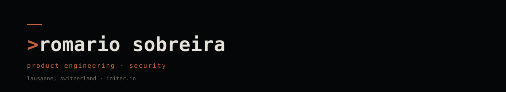

  

**Founder [@Initer](https://initer.io) · product engineering & security · Lausanne**

I build products and systems where real-world communities, data and security meet —
from the schema and the API to the interface and the deploy.

## Selected work

| Project | What it is |
|---|---|
| **[Initer](https://initer.io)** | Social infrastructure for real-life experiences — discovery, social, ticketing. One platform for organizers and their communities. |
| **Arsenal** | Private R&D lab: OSINT, red team, detection measurement, MCP gateway, agent console. |
| **[Peekly](https://github.com/rosoam/peekly)** | Hold X to inspect any React/Vue/Preact/Alpine component; live network inspector with N+1 detection and TypeScript interface generation. |
| **[Droplink](https://github.com/rosoam/droplink)** | AirDrop for everyone — P2P LAN file sharing, no account, no server. |

## How I work

- **Product first** — ship the narrow thing that proves the thesis, then widen it.
- **Security by construction** — threat models, least privilege, evidence, not claims.
- **Agentic workflows** — agents where they remove real toil, with rails and measurable output.
- **End-to-end** — product, architecture, code, operations. No hand-off.

## Stack

**Product** — TypeScript, Next.js, React, Flutter  
**Systems** — Rust, Python, FastAPI, Fastify  
**Data** — PostgreSQL, Supabase, Redis  
**Platform** — Docker, Vercel, Cloudflare, Stripe, WorkOS

## Find me

[initer.io/rso](https://initer.io/rso) · [LinkedIn](https://www.linkedin.com/in/romario-sobreira/) · [GitHub](https://github.com/rosoam)
